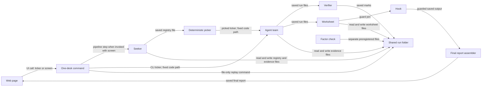

# Three Musketeers — Zainab, Ansh, Krishmi

Our client is a long-term individual investor seeking capital appreciation, with moderate risk tolerance and a preference for evidence-based recommendations supported by SEC filings and transparent valuation assumptions.

## Desk joins



“The desk uses a file-based pipeline from the seeker to the deterministic pick, from the agent team’s saved run to the worksheet, and from the worksheet to the final report; the hook guards every worksheet and report output, and no model chooses the execution order or recomputes a skill’s numbers.”

The pipeline order is fixed in `one_desk.py`. The hook validates worksheet and final-report numeric claims against saved filings and computations. The web page calls the one-desk command and displays its saved final report. Replay is file-only. The factor check is a separate evaluation and does not alter production factors.

## Team-owned feature

The Three Musketeers own a factor-check feature that fixes each factor’s definition, direction, weight, point rule, and evaluation window before any return is observed, records every comparison it runs, and reports the resulting hit rate without changing the rules after seeing the outcomes.

## Roles

- Zainab — Integration and live-record lead: owns the starting agent desk, connects the team’s tools under one command, and maintains the final live record and submission evidence.
- Ansh — Verification and evidence lead: checks report claims against SEC filings, runs the clean and seeded-error verification tests, and records the resulting marks.
- Krishmi — Seeker and valuation lead: manages the factor definitions and spinoff screen, runs the investor worksheet, and documents the valuation assumptions and results.

## Live record

| Ticker | Release | Filing Accepted time and timezone | View time | Commit time | 24-hour result | Permanent run/report link |
|---|---|---|---|---|---|---|
| MATW | Fourth-quarter and fiscal-year 2026 earnings, period ended September 30, 2026 | 2026-11-20 08:22:14 EST (UTC−05:00), accession 0000063296-26-000118 | Not captured; no pre-reaction time is asserted | 2026-11-20 22:52:13 EST (UTC−05:00), commit `bda922d626e4c59cd0ba1129063360731b01e421` | Inside; before 2026-11-21 08:22:14 EST | [Live report](runs/live/MATW_TEAM_WORKSHEET_FINAL/MATW_LIVE_REPORT.md) · [Live record](runs/live/MATW_TEAM_WORKSHEET_FINAL/live_record.json) |

The live report includes the mandatory Verifier marks: 16 correct, 4 wrong, and 37 unsupported. The worksheet view is not computed because the required aligned owner-cash-flow and share inputs are unavailable. The report does not publish a value range.

## Evidence links

- Lab 06 corrected run: [seeker report](lab06_runs/SEEKER_2026-11-20_22-29-06-302032/seeker_report.md), [registry](lab06_runs/SEEKER_2026-11-20_22-29-06-302032/registry.json), [62-quote filing audit](lab06_runs/SEEKER_2026-11-20_22-29-06-302032/citation_audit.json), [validation](LAB06_VALIDATION.md), [zero-weight proof](lab06_runs/SEEKER_2026-11-20_22-29-06-302032/weight_zero_proof_2026-11-20_22-49-34-990421/proof.json), [original 18-record factual table](LAB06_SPINOFF_PARTNER_TABLE.md).
- Lab 07 worksheet rules: [persona](skills/spinoff-worksheet/investor_persona.md), [configuration](skills/spinoff-worksheet/worksheet_config.json). MSGR one-desk attempt: [saved failure](runs/desk/DESK_2026-11-20_22-53-23-552966/failure.json). The existing team requires a primary 10-K; the saved MSGR submissions have a 10-Q, registration statement, and 8-K, but no 10-K. No MSGR worksheet or model call is represented as complete.
- MSGR saved input and worksheet status: [saved registry facts](runs/lab07/MSGR_evidence/verified_registry_facts.json), [information statement](runs/lab07/MSGR_evidence/Form10_0001193125-26-409182_information.txt), [price response](runs/lab07/MSGR_evidence/MSGR_2026-10-26_2026-11-19.json), [worksheet status](runs/lab07/MSGR_worksheet_status.md).
- Hook implementation and tests: [hook](skills/spinoff-worksheet/spinoff_worksheet_hook.py), [worksheet tests](equity_research_team/tests/test_worksheet.py), [one-desk tests](tests/test_one_desk.py). Actual clean/seeded worksheet evidence: [clean](runs/lab07/hook_proofs/clean_result.txt), [seeded](runs/lab07/hook_proofs/seeded_result.txt). Actual clean/seeded final-report evidence: [clean](runs/lab08/hook_proofs/clean_result.txt), [seeded](runs/lab08/hook_proofs/seeded_result.txt).
- Lab 08 empty-screen run: [final report](runs/desk/DESK_2026-11-20_22-55-01-801000/final_report.md), [picker](runs/desk/DESK_2026-11-20_22-55-01-801000/picker.json), [offline replay proof](runs/desk/DESK_2026-11-20_22-55-01-801000/replay/replay_proof.json). Replay is byte-identical and recorded zero network calls. A later timing-corrected live attempt stopped on a premature SEC response; its exact failure is saved at `runs/desk/DESK_2026-11-20_23-27-39-420799/failure.json`.
- Lab 09 filing evidence and audit: [NVDA filings](runs/lab09/NVDA_evidence/manifest.json), [NVDA audit](runs/lab09/NVDA_evidence/audit.md), [NVDA comparison](LAB09_NVDA_COMPARISON.md); [WMT filings](runs/lab09/WMT_evidence/manifest.json), [WMT audit](runs/lab09/WMT_evidence/audit.md). Attempts: [NVDA failure](runs/lab09/DESK_2026-11-20_22-59-43-273213/failure.json), [WMT failure](runs/lab09/DESK_2026-11-20_23-12-58-930177/failure.json). Both stopped when OpenAI returned HTTP 429 `credit_balance_exhausted`; neither has a verified final report.
- Factor check: [preregistration and limits](runs/lab07/factor_check_plan.md), [hit-rate table](runs/factor_check/hit_rate_table.md). There are zero prospective comparisons; no validation is claimed.
- Model cutoff: [probe result and official documentation](runs/lab07/model_cutoff_probe.json). The live probe failed for lack of API credits; OpenAI's official GPT-6 Astra page documents an April 30, 2026 cutoff.
- WRDS command: [implementation](wrds_crsp_reaction.py), [pending login result](runs/wrds/crsp_reaction.json). It does not substitute Financial Datasets for CRSP.
- Test proof: see exact commands below. The latest full test count is recorded in the final run notes.
- Latest test/evidence summary: [validation record](runs/checkpoint3/test_results.md).

## Limitations and pending items

- Automated evidence audits are labeled as Codex audits. No teammate or partner manual check is marked PASS.
- Lab 09 uses the instructor-authorized Codex selector substitution relayed by Zainab; no outside-team student selector was represented.
- Lab 06 has no ranked names. Seven of 17 classified records have no established distribution date; eight have saved first regular closes, all after the recorded distribution date. Some prices remain unavailable.
- MSGR’s saved SEC submissions do not include a primary 10-K. The existing agent team fails closed. OpenAI API usage is blocked by HTTP 429 `credit_balance_exhausted`; this blocks the MSGR worksheet persona call and the MSGR/NVDA/WMT live agent reports. The clean and seeded hook proofs did run offline and pass/refuse as expected.
- A first live empty-screen run succeeded, but its saved timing instrumentation did not record each part separately. The timing-corrected second screen stopped on an SEC `Response ended prematurely` error. A successful empty-screen run with corrected per-part timing remains pending.
- WRDS access is absent: **PENDING WRDS LOGIN — no authorized credentials available.** No CRSP comparisons or hand-recomputed CRSP row are available.
- The MATW view time was not captured before the release. The first valid report commit was inside the 24-hour window, but it does not establish a pre-reaction view.
- Historical factor outcomes were observed before the prospective factor-check registration and are excluded. The available prospective sample has zero comparisons.
- No value range is reported where owner cash flow, shares, price, or other required inputs cannot be established.

## Reproducible commands

Run from the repository root. Put secret values in the ignored `.env`; never put them in command arguments.

```bash
uv sync --project equity_research_team --locked
python check_env.py
UV_CACHE_DIR=/tmp/checkpoint3-uv-cache uv run --project equity_research_team --locked pytest -q equity_research_team/tests tests
UV_CACHE_DIR=/tmp/checkpoint3-uv-cache uv run --project equity_research_team --locked python skills/spinoff-seeker/scripts/seeker.py run --start-date 2025-11-18 --end-date 2026-11-20 --output-root lab06_runs
UV_CACHE_DIR=/tmp/checkpoint3-uv-cache uv run --project equity_research_team --locked python skills/spinoff-seeker/scripts/seeker.py prove-zero-weight --base-run lab06_runs/SEEKER_2026-11-20_22-29-06-302032
UV_CACHE_DIR=/tmp/checkpoint3-uv-cache uv run --project equity_research_team --locked python one_desk.py run MSGR --run-root runs/desk --registry lab06_runs/SEEKER_2026-11-20_22-29-06-302032/registry.json
UV_CACHE_DIR=/tmp/checkpoint3-uv-cache uv run --project equity_research_team --locked python audit_lab06_citations.py --run lab06_runs/SEEKER_2026-11-20_22-29-06-302032 --output /tmp/lab06-citation-audit.json
cp -R runs/live/MATW_TEAM_WORKSHEET_FINAL /tmp/MATW_worksheet_replay
UV_CACHE_DIR=/tmp/checkpoint3-uv-cache uv run --project equity_research_team --locked python skills/spinoff-worksheet/worksheet.py /tmp/MATW_worksheet_replay MATW
UV_CACHE_DIR=/tmp/checkpoint3-uv-cache uv run --project equity_research_team --locked python skills/spinoff-worksheet/spinoff_worksheet_hook.py runs/live/MATW_TEAM_WORKSHEET_FINAL/MATW_LIVE_REPORT.md --evidence runs/live/MATW_TEAM_WORKSHEET_FINAL
UV_CACHE_DIR=/tmp/checkpoint3-uv-cache uv run --project equity_research_team --locked python one_desk.py run MSGR --run-root runs/desk
UV_CACHE_DIR=/tmp/checkpoint3-uv-cache uv run --project equity_research_team --locked python one_desk.py run SCREEN --run-root runs/desk
UV_CACHE_DIR=/tmp/checkpoint3-uv-cache uv run --project equity_research_team --locked python one_desk.py run NVDA --run-root runs/lab09
UV_CACHE_DIR=/tmp/checkpoint3-uv-cache uv run --project equity_research_team --locked python one_desk.py run WMT --run-root runs/lab09
UV_CACHE_DIR=/tmp/checkpoint3-uv-cache uv run --project equity_research_team --locked python one_desk.py replay runs/desk/DESK_TIMESTAMP
UV_CACHE_DIR=/tmp/checkpoint3-uv-cache uv run --project equity_research_team --locked python factor_check.py hit-rate --output runs/factor_check/hit_rate_table.md
UV_CACHE_DIR=/tmp/checkpoint3-uv-cache uv run --project equity_research_team --locked python factor_check.py run --output runs/factor_check
UV_CACHE_DIR=/tmp/checkpoint3-uv-cache uv run --project equity_research_team --locked python wrds_crsp_reaction.py --events runs/wrds/costco_eight_events.csv --output runs/wrds/crsp_reaction.json
cd equity_research_team && UV_CACHE_DIR=/tmp/checkpoint3-uv-cache uv run page
```

This desk produces screens, not recommendations.
