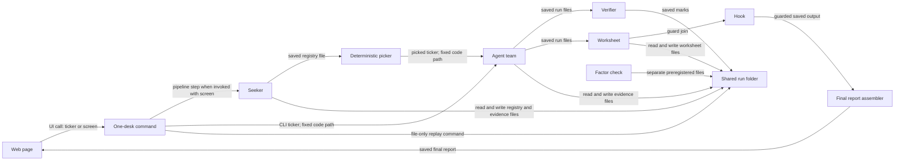

# Three Musketeers — Zainab, Ansh, Krishmi

Our client is a long-term individual investor seeking capital appreciation, with moderate risk tolerance and a preference for evidence-based recommendations supported by SEC filings and transparent valuation assumptions.

## Desk joins



“The desk uses a file-based pipeline from the seeker to the deterministic pick, from the agent team’s saved run to the worksheet, and from the worksheet to the final report; the hook guards every worksheet and report output, and no model chooses the execution order or recomputes a skill’s numbers.”

The pipeline order is fixed in `one_desk.py`. The hook validates worksheet and final-report numeric claims against saved filings and computations. The web page calls the one-desk command and displays its saved final report. Replay is file-only. The factor check is a separate evaluation and does not alter production factors.

## Team-owned feature

The Three Musketeers own a factor-check feature that fixes each factor’s definition, direction, weight, point rule, and evaluation window before any return is observed, records every comparison it runs, and reports the resulting hit rate without changing the rules after seeing the outcomes.

## Roles

- Zainab — Integration and live-record lead: owns the starting agent desk, connects the team’s tools under one command, and maintains the final live record and submission evidence.
- Ansh — Verification and evidence lead: checks report claims against SEC filings, runs the clean and seeded-error verification tests, and records the resulting marks.
- Krishmi — Seeker and valuation lead: manages the factor definitions and spinoff screen, runs the investor worksheet, and documents the valuation assumptions and results.

## Live record

| Ticker | Release | Filing Accepted time and timezone | View time | Commit time | 24-hour result | Permanent run/report link |
|---|---|---|---|---|---|---|
| MATW | Fourth-quarter and fiscal-year 2026 earnings, period ended September 30, 2026 | 2026-11-20 08:22:14 EST (UTC−05:00), accession 0000063296-26-000118 | Not captured; no pre-reaction time is asserted | 2026-11-20 22:52:13 EST (UTC−05:00), commit `bda922d626e4c59cd0ba1129063360731b01e421` | Inside; before 2026-11-21 08:22:14 EST | [Live report](runs/live/MATW_TEAM_WORKSHEET_FINAL/MATW_LIVE_REPORT.md) · [Live record](runs/live/MATW_TEAM_WORKSHEET_FINAL/live_record.json) |

The live report includes the mandatory Verifier marks: 16 correct, 4 wrong, and 37 unsupported. The worksheet view is not computed because the required aligned owner-cash-flow and share inputs are unavailable. The report does not publish a value range.

## Evidence links

- Lab 06 corrected run: [seeker report](lab06_runs/SEEKER_2026-11-20_22-29-06-302032/seeker_report.md), [registry](lab06_runs/SEEKER_2026-11-20_22-29-06-302032/registry.json), [62-quote filing audit](lab06_runs/SEEKER_2026-11-20_22-29-06-302032/citation_audit.json), [validation](LAB06_VALIDATION.md), [zero-weight proof](lab06_runs/SEEKER_2026-11-20_22-29-06-302032/weight_zero_proof_2026-11-20_22-49-34-990421/proof.json), [original 18-record factual table](LAB06_SPINOFF_PARTNER_TABLE.md).
- Lab 07 workflow: [filing selector and annual-fact limits](equity_research_data.py), [regression tests](tests/test_equity_research_data.py). The MSGR run selected primary Form 10-Q accession `0001628280-26-071325`, filed November 6, 2026, period ended September 30, 2026. Its selection reason and period are recorded in [the agent manifest](runs/desk/DESK_2026-11-22_13-31-53-865623/agent/MSG_Rangers_Corp_2026-11-22_13-31-54-793145/manifest.json). Annual-only values are marked not established. See the saved [facts](runs/desk/DESK_2026-11-22_13-31-53-865623/agent/MSG_Rangers_Corp_2026-11-22_13-31-54-793145/facts.json), [persona input](runs/desk/DESK_2026-11-22_13-31-53-865623/agent/MSG_Rangers_Corp_2026-11-22_13-31-54-793145/persona_model_input.json), [persona output](runs/desk/DESK_2026-11-22_13-31-53-865623/agent/MSG_Rangers_Corp_2026-11-22_13-31-54-793145/persona_model_call.json), [worksheet](runs/desk/DESK_2026-11-22_13-31-53-865623/agent/MSG_Rangers_Corp_2026-11-22_13-31-54-793145/worksheet.md), and [verified team report](runs/desk/DESK_2026-11-22_13-31-53-865623/agent/MSG_Rangers_Corp_2026-11-22_13-31-54-793145/verified_report.md). Owner cash flow, low and midpoint values, and view remain not computed because no comparable post-spin cash-flow baseline or aligned shares are established. The saved close and liquidity comparison are recorded; Krishmi’s two manual recomputations remain pending.
- Lab 08 successful MSGR joined run: [final report](runs/desk/DESK_2026-11-22_13-31-53-865623/final_report.md), [manifest](runs/desk/DESK_2026-11-22_13-31-53-865623/run_manifest.json), [node order](runs/desk/DESK_2026-11-22_13-31-53-865623/agent/MSG_Rangers_Corp_2026-11-22_13-31-54-793145/node_order.json), [clean and seeded hook results](runs/desk/DESK_2026-11-22_13-31-53-865623/hook_proofs), and [offline replay proof](runs/desk/DESK_2026-11-22_13-31-53-865623/replay/replay_proof.json). Replay passed with zero network and model calls and identical final-report content. The timing-corrected [SCREEN run](runs/desk/DESK_2026-11-22_13-37-17-802277/final_report.md) completed with no ranked ticker and includes per-part timing records.
- Hook implementation and tests: [hook](skills/spinoff-worksheet/spinoff_worksheet_hook.py), [worksheet tests](equity_research_team/tests/test_worksheet.py), [one-desk tests](tests/test_one_desk.py). Earlier clean/seeded hook proofs remain at [Lab 07](runs/lab07/hook_proofs) and [Lab 08](runs/lab08/hook_proofs).
- Lab 09 filings and partial agent outputs: current [NVDA run](runs/lab09/DESK_2026-11-22_13-37-32-104848) and [WMT run](runs/lab09/DESK_2026-11-22_13-37-44-279695). Both saved filings, facts, and initial analyst outputs. Both stopped at the Investment Advisor call with HTTP 429 `credit_balance_exhausted`; neither has a final verified report, worksheet, view, or deciding number. The [NVDA comparison](LAB09_NVDA_COMPARISON.md) records the unavailable joined report and differences. Manual review fields remain pending.
- Local webpage health returned `{"status":"ok"}`. The [MSGR UI evidence](runs/desk/DESK_2026-11-22_13-40-27-300160/ui_evidence.json) records a failed run after an API 429, so no successful report display is claimed. The page invokes the same `one_desk.py run` command as the terminal workflow.

- Factor check: [preregistration and limits](runs/lab07/factor_check_plan.md), [hit-rate table](runs/factor_check/hit_rate_table.md). There are zero prospective comparisons; no validation is claimed.
- Model cutoff: [probe result and official documentation](runs/lab07/model_cutoff_probe.json). The live probe failed for lack of API credits; OpenAI's official GPT-6 Astra page documents an April 30, 2026 cutoff.
- WRDS / CRSP: [implementation](wrds_crsp_reaction.py), [eight SEC events](runs/wrds/costco_eight_events.csv), [54 CRSP source rows](runs/wrds/costco_crsp_daily.csv), [calculations and validation](runs/wrds/crsp_reaction.json), and [methodology and reproducible command](runs/wrds/crsp_reaction_methodology.md). The run uses the current CRSP CIZ `crsp.dsf_v2` table and does not substitute another data provider.
- Test proof: see exact commands below. Latest full locked run: 72 passed.
- Latest test/evidence summary: [validation record](runs/checkpoint3/test_results.md).

## Costco eight-event CRSP reaction

The account connected to WRDS and had access to the `crsp` library. The account's Costco CIZ data ends on December 31, 2025. Therefore, the analysis uses the latest eight Costco Item 2.02 8-K events with complete reaction windows in that data: March 7, 2024 through December 11, 2025. It does not use the three 2026 SEC events because the subscribed CRSP snapshot has no 2026 rows.

| SEC acceptance date | Accession | Last close before | First close after | Reaction |
|---|---|---:|---:|---:|
| 2024-03-07 | 0000909832-24-000012 | $785.59 | $725.56 | -7.6414% |
| 2024-05-30 | 0000909832-24-000026 | $815.34 | $809.89 | -0.6684% |
| 2024-09-26 | 0000909832-24-000043 | $901.44 | $885.62 | -1.7550% |
| 2024-12-12 | 0000909832-24-000075 | $988.39 | $989.35 | 0.0971% |
| 2025-03-06 | 0000909832-25-000012 | $1,026.62 | $964.31 | -6.0694% |
| 2025-05-29 | 0000909832-25-000031 | $1,008.74 | $1,040.18 | 3.1168% |
| 2025-09-25 | 0000909832-25-000093 | $943.31 | $915.95 | -2.9004% |
| 2025-12-11 | 0000909832-25-000164 | $884.48 | $884.47 | -0.0011% |

All eight reactions are complete. Two are positive. The unrounded mean is -1.977736679324163364381306051%, and the unrounded median is -1.211701313548072472846480770%. The saved JSON retains the unrounded event calculations. The methodology includes a source-price arithmetic check, and the offline test suite independently recalculates all eight rows from the saved CRSP CSV.

## Limitations and pending items

- Automated evidence audits are labeled as automated audits. No teammate or partner manual check is marked PASS. Ansh’s report checks, Krishmi’s two worksheet recomputations, and the outside-team reviewer’s manual review remain pending.
- Lab 09 uses NVDA and WMT as test companies. No outside-team student selector is documented.
- Lab 06 has no ranked names. Seven of 17 classified records have no established distribution date; eight have saved first regular closes, all after the recorded distribution date. Some prices remain unavailable.
- MSGR has no primary 10-K in the saved submissions. The new selector uses its first primary 10-Q filed after the distribution date and preserves the pre-distribution period end. Its annual-only facts and unsupported owner-cash-flow values remain not established. One real completion smoke request passed with model `gpt-6-astra`. Later live model calls returned HTTP 429 `credit_balance_exhausted` with message `You have no credits remaining` (sanitized; no key or request headers were saved); this stopped the NVDA, WMT, and webpage runs before final reports.
- A new timing-corrected SCREEN run completed with no ranked ticker and separate timings for each part. The successful MSGR run replay passed with zero network calls, zero model calls, and identical final-report content.
- The subscribed Costco CRSP CIZ data ends on December 31, 2025. The completed eight-event analysis therefore excludes three later 2026 SEC earnings filings. This is a data-availability cutoff, not an authentication or coding failure.
- The MATW view time was not captured before the release. The first valid report commit was inside the 24-hour window, but it does not establish a pre-reaction view.
- Historical factor outcomes were observed before the prospective factor-check registration and are excluded. The available prospective sample has zero comparisons.
- No value range is reported where owner cash flow, shares, price, or other required inputs cannot be established.

## Reproducible commands

Run from the repository root. Put secret values in the ignored `.env`; never put them in command arguments.

```bash
uv sync --project equity_research_team --locked
python check_env.py
UV_CACHE_DIR=/tmp/checkpoint3-uv-cache uv run --project equity_research_team --locked pytest -q equity_research_team/tests tests
UV_CACHE_DIR=/tmp/checkpoint3-uv-cache uv run --project equity_research_team --locked python skills/spinoff-seeker/scripts/seeker.py run --start-date 2025-11-18 --end-date 2026-11-20 --output-root lab06_runs
UV_CACHE_DIR=/tmp/checkpoint3-uv-cache uv run --project equity_research_team --locked python skills/spinoff-seeker/scripts/seeker.py prove-zero-weight --base-run lab06_runs/SEEKER_2026-11-20_22-29-06-302032
UV_CACHE_DIR=/tmp/checkpoint3-uv-cache uv run --project equity_research_team --locked python one_desk.py run MSGR --run-root runs/desk --registry lab06_runs/SEEKER_2026-11-20_22-29-06-302032/registry.json
UV_CACHE_DIR=/tmp/checkpoint3-uv-cache uv run --project equity_research_team --locked python audit_lab06_citations.py --run lab06_runs/SEEKER_2026-11-20_22-29-06-302032 --output /tmp/lab06-citation-audit.json
cp -R runs/live/MATW_TEAM_WORKSHEET_FINAL /tmp/MATW_worksheet_replay
UV_CACHE_DIR=/tmp/checkpoint3-uv-cache uv run --project equity_research_team --locked python skills/spinoff-worksheet/worksheet.py /tmp/MATW_worksheet_replay MATW
UV_CACHE_DIR=/tmp/checkpoint3-uv-cache uv run --project equity_research_team --locked python skills/spinoff-worksheet/spinoff_worksheet_hook.py runs/live/MATW_TEAM_WORKSHEET_FINAL/MATW_LIVE_REPORT.md --evidence runs/live/MATW_TEAM_WORKSHEET_FINAL
UV_CACHE_DIR=/tmp/checkpoint3-uv-cache uv run --project equity_research_team --locked python one_desk.py run MSGR --run-root runs/desk
UV_CACHE_DIR=/tmp/checkpoint3-uv-cache uv run --project equity_research_team --locked python one_desk.py run SCREEN --run-root runs/desk
UV_CACHE_DIR=/tmp/checkpoint3-uv-cache uv run --project equity_research_team --locked python one_desk.py run NVDA --run-root runs/lab09
UV_CACHE_DIR=/tmp/checkpoint3-uv-cache uv run --project equity_research_team --locked python one_desk.py run WMT --run-root runs/lab09
UV_CACHE_DIR=/tmp/checkpoint3-uv-cache uv run --project equity_research_team --locked python one_desk.py replay runs/desk/DESK_TIMESTAMP
UV_CACHE_DIR=/tmp/checkpoint3-uv-cache uv run --project equity_research_team --locked python factor_check.py hit-rate --output runs/factor_check/hit_rate_table.md
UV_CACHE_DIR=/tmp/checkpoint3-uv-cache uv run --project equity_research_team --locked python factor_check.py run --output runs/factor_check
UV_CACHE_DIR=/tmp/checkpoint3-uv-cache uv run --project equity_research_team --locked python wrds_crsp_reaction.py --smoke-test
UV_CACHE_DIR=/tmp/checkpoint3-uv-cache uv run --project equity_research_team --locked python wrds_crsp_reaction.py --events runs/wrds/costco_eight_events.csv --source-output runs/wrds/costco_crsp_daily.csv --output runs/wrds/crsp_reaction.json --methodology-output runs/wrds/crsp_reaction_methodology.md
cd equity_research_team && UV_CACHE_DIR=/tmp/checkpoint3-uv-cache uv run page
```

This desk produces screens, not recommendations.
