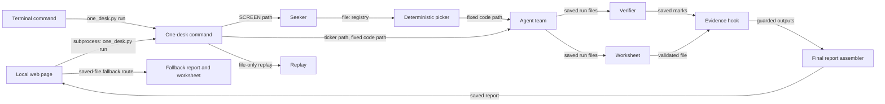

# Three Musketeers — Zainab, Ansh, Krishmi

Our client is a long-term individual investor seeking capital appreciation, with moderate risk tolerance and a preference for evidence-based recommendations supported by SEC filings and transparent valuation assumptions.

Overall status: **NOT 100% COMPLETE**. The saved-only technical corrections and fallback packages are complete. The required live Lab 09 joined outputs, successful live joined-model webpage display, Ansh’s MATW review, the genuine outside-team review, and the MATW pre-reaction view remain missing.

## Desk design

The local web page and terminal workflow use the same `one_desk.py` command. The pipeline uses saved files and a fixed code-defined order. A deterministic screen can select a ticker from the saved registry. The agent team saves filing-based work. The verifier and worksheet consume saved run files. A hook checks worksheet and report outputs before the final report assembler writes its report. Replay reads saved files only.

## Joins

- The seeker joins to the deterministic picker through the saved registry file.
- The ticker or selected name joins to the agent team through a fixed code path in `one_desk.py`.
- The verifier and worksheet join to the agent run through saved files in the run folder.
- The hook joins the worksheet and verifier evidence by reading saved outputs and validating numeric claims.
- The final assembler joins the guarded outputs by reading their saved files.
- The web page joins to the desk by starting the same `one_desk.py run` command in a subprocess.
- The explicit fallback-display route reads only the declared saved NVDA or WMT fallback package. It does not start the desk, access the network, or call a model.
- Replay joins only to saved run files. It makes no network or model calls.

## Team-owned feature

The team owns a prospective factor-check feature. It fixes each factor’s definition, direction, weight, point rule, and evaluation window before observing returns. It records each comparison and reports a hit rate. The saved prospective sample has zero comparisons, so no factor validation is claimed.

## Team roles

- Zainab — Integration and live-record lead; connects the tools under one command and maintains the live record and submission evidence.
- Ansh — Verification and evidence lead; checks report claims against SEC filings and records the assigned review results.
- Krishmi — Seeker and valuation lead; maintains factor definitions and the spinoff screen and completes the assigned worksheet recomputations.

## Live record so far

| Ticker | Release | Filing Accepted time | View time | Commit time | 24-hour result | Permanent GitHub evidence |
|---|---|---|---|---|---|---|
| MATW | Fourth-quarter and fiscal-year 2026 earnings, period ended September 30, 2026 | November 20, 2026, 08:22:14 EST (UTC−05:00); accession `0000063296-26-000118` | Not captured; no pre-reaction view time is asserted | November 20, 2026, 22:52:13 EST (UTC−05:00); commit [`bda922d626e4c59cd0ba1129063360731b01e421`](https://github.com/zainnn12/FIN67110-Fall2026/commit/bda922d626e4c59cd0ba1129063360731b01e421) | Inside; before November 21, 2026, 08:22:14 EST | [MATW live report at the recorded commit](https://github.com/zainnn12/FIN67110-Fall2026/blob/bda922d626e4c59cd0ba1129063360731b01e421/runs/live/MATW_TEAM_WORKSHEET_FINAL/MATW_LIVE_REPORT.md) · [saved live record](runs/live/MATW_TEAM_WORKSHEET_FINAL/live_record.json) |

The MATW report records verifier marks of 16 correct, 4 wrong, and 37 unsupported. The worksheet view and value range were not computed because aligned owner-cash-flow and share inputs were unavailable. The saved MATW live report does not establish a pre-reaction view. The [AI MATW pre-review](MATW_REVIEW.md) confirms a 14:29:59 acceptance-to-commit interval but does not replace Ansh’s pending review.

## Checkpoint 3 evidence

### Lab 06

- [Corrected Lab 06 run](lab06_runs/SEEKER_2026-11-20_22-29-06-302032/seeker_report.md), [registry](lab06_runs/SEEKER_2026-11-20_22-29-06-302032/registry.json), and [citation audit](lab06_runs/SEEKER_2026-11-20_22-29-06-302032/citation_audit.json).
- [Zero-weight proof](lab06_runs/SEEKER_2026-11-20_22-29-06-302032/weight_zero_proof_2026-11-20_22-49-34-990421/proof.json), [Lab 06 validation](LAB06_VALIDATION.md), and [Ansh's completed review section](02_LAB06_VALIDATION_section_COMPLETED.md). Ansh completed the independent manual review on November 22, 2026. The saved screen has no ranked name.
- Ansh marked Cortigent **FAIL** because the saved evidence contradicts the registry's October 8, 2025 record date and pending spin-off status. He marked the Octave and BioKey insider checks **NOT VERIFIABLE** and the MSG Rangers insider check **INCOMPLETE PERIOD**. His 12 PASS marks and all 8 stated limitations remain unchanged. The historical run is preserved; the separate [Cortigent correction artifact](lab06_runs/SEEKER_2026-11-20_22-29-06-302032/CORRECTION_CORTIGENT_2026-11-22.json) clears the withdrawn record date and removes Cortigent from registered/watch eligibility.

### Lab 07

- The saved MSGR joined run’s [final report](runs/desk/DESK_2026-11-22_13-31-53-865623/final_report.md) and [manifest](runs/desk/DESK_2026-11-22_13-31-53-865623/run_manifest.json) show that the run completed. It selected Form 10-Q accession `0001628280-26-071325`, filed November 6, 2026, for the period ended September 30, 2026. The period predates the October 26, 2026 distribution.
- Krishmi’s [completed manual review](runs/lab07/KRISHMI_MANUAL_REVIEW.md) records two **FAIL** marks: the original worksheet did not compute the available owner-cash-flow value or the available low-case value per share. Her calculations, conclusions, review date of November 22, 2026, and both FAIL marks are unchanged.
- The [correction record](runs/lab07/MSGR_WORKSHEET_CORRECTION_2026-11-22.json) and corrected [worksheet](runs/desk/DESK_2026-11-22_13-31-53-865623/agent/MSG_Rangers_Corp_2026-11-22_13-31-54-793145/worksheet.md) use Form 10 accession `0001193125-26-409182` for the single matching fiscal year from July 1, 2025 through June 30, 2026. The source units are USD thousands, except shares in thousands. The inputs are pro forma net loss of −$26,801,000 at line 1791, depreciation and amortization of $2,348,000 at line 1781, capital expenditures of −$634,000 at line 5108 with its absolute value subtracted, and pro forma diluted weighted-average shares of 12,077,000 at line 1797.
- The corrected owner cash flow is −$25.087 million. The low-case equity value and value per share are $0.00. The [offline worksheet proof](runs/desk/DESK_2026-11-22_13-31-53-865623/agent/MSG_Rangers_Corp_2026-11-22_13-31-54-793145/worksheet_offline_proof.json), [hook result](runs/desk/DESK_2026-11-22_13-31-53-865623/hook_result.json), and [offline replay proof](runs/desk/DESK_2026-11-22_13-31-53-865623/replay/replay_proof.json) record zero model calls, zero network calls for regeneration and replay, a clean hook PASS, and a byte-identical replay. The pre-spin 10-Q is not annualized and is not mixed with the annual Form 10 period.

### Lab 08

- [Successful MSGR joined run](runs/desk/DESK_2026-11-22_13-31-53-865623/final_report.md) with [fixed node order](runs/desk/DESK_2026-11-22_13-31-53-865623/agent/MSG_Rangers_Corp_2026-11-22_13-31-54-793145/node_order.json), individual timings, and [manifest](runs/desk/DESK_2026-11-22_13-31-53-865623/run_manifest.json).
- [Clean hook PASS](runs/desk/DESK_2026-11-22_13-31-53-865623/hook_proofs/clean_result.txt), [seeded-error refusal](runs/desk/DESK_2026-11-22_13-31-53-865623/hook_proofs/seeded_result.txt), and [offline replay proof](runs/desk/DESK_2026-11-22_13-31-53-865623/replay/replay_proof.json). Replay recorded zero network calls, zero model calls, and identical report hashes and content.
- The timing-corrected [SCREEN result](runs/desk/DESK_2026-11-22_13-37-17-802277/final_report.md) has no ranked ticker. It does not select a company.

### Lab 09

- NVDA saved-only package: [fallback report](runs/lab09/DESK_2026-11-22_13-37-32-104848/fallback_report.md), deterministic fallback worksheet in [Markdown](runs/lab09/DESK_2026-11-22_13-37-32-104848/fallback_worksheet.md) and [JSON](runs/lab09/DESK_2026-11-22_13-37-32-104848/fallback_worksheet.json), [fallback manifest](runs/lab09/DESK_2026-11-22_13-37-32-104848/fallback_manifest.json), saved filing [manifest](runs/lab09/DESK_2026-11-22_13-37-32-104848/agent/NVIDIA_CORP_2026-11-22_13-37-33-357977/manifest.json), and [failure record](runs/lab09/DESK_2026-11-22_13-37-32-104848/failure.json).
- WMT saved-only package: [fallback report](runs/lab09/DESK_2026-11-22_13-37-44-279695/fallback_report.md), deterministic fallback worksheet in [Markdown](runs/lab09/DESK_2026-11-22_13-37-44-279695/fallback_worksheet.md) and [JSON](runs/lab09/DESK_2026-11-22_13-37-44-279695/fallback_worksheet.json), [fallback manifest](runs/lab09/DESK_2026-11-22_13-37-44-279695/fallback_manifest.json), saved filing [manifest](runs/lab09/DESK_2026-11-22_13-37-44-279695/agent/Walmart_Inc_2026-11-22_13-37-46-216137/manifest.json), and [failure record](runs/lab09/DESK_2026-11-22_13-37-44-279695/failure.json).
- The [corrected NVIDIA comparison](LAB09_NVDA_COMPARISON.md) uses the November 17, 2026 release date and November 17, 2026, 16:20:51 Eastern Time acceptance. It cites line 145 for exact $115.844 billion revenue; lines 8, 14, and 21 for 103% growth; lines 10 and 50 for $107.6 billion Data Center revenue and 110% growth; and line 156 for exact $65.287 billion GAAP net income. Line 25 is identified only as the rounded $65.3 billion summary.
- Both joined runs stopped at the Investment Advisor call after HTTP 429 `credit_balance_exhausted`. No new model call was made. Parts-alone output, joined final reports, joined worksheets, verified reports, views, convictions, and deciding numbers were not produced. The comparison keeps differences and investment conclusions NOT ASSESSABLE.
- NVDA owner cash flow and valuation are NOT COMPUTABLE because a matched annual or trailing-12-month basis and property-only capital expenditures are missing. WMT’s matched nine-month diagnostic is $6.256 billion, but it is not annualized and is excluded from valuation; the required WMT valuation is NOT COMPUTABLE.
- The [AI outside-team pre-review](OUTSIDE_TEAM_REVIEW.md) checks the saved citations and failure boundaries. It is not the required genuine outside-team student review.

### WRDS / CRSP

- [Eight event list](runs/wrds/costco_eight_events.csv), [saved CRSP source rows](runs/wrds/costco_crsp_daily.csv), [calculations and validation](runs/wrds/crsp_reaction.json), and [methodology and reproducible command](runs/wrds/crsp_reaction_methodology.md).
- The CRSP CIZ snapshot ends December 31, 2025. The analysis therefore does not include three 2026 SEC events.

### Local webpage

- [Local page evidence](runs/checkpoint3/LOCAL_PAGE_EVIDENCE.md) records the health response, unchanged normal joined path, failed prior MSGR UI request, and successful saved-only fallback route for NVDA and WMT.
- The fallback route displays the exact banner `Fallback evidence — not a successful live model-assisted report` and identifies the ticker, saved run, failure reason, report path, worksheet path, and missing outputs. The [NVDA](runs/lab09/DESK_2026-11-22_13-37-32-104848/fallback_ui_evidence.json) and [WMT](runs/lab09/DESK_2026-11-22_13-37-44-279695/fallback_ui_evidence.json) response records state zero network calls, zero model calls, and `live_joined_report_succeeded: false`.
- No screenshot was captured because the available browser-capture host was unavailable. A successful live model-assisted report display is still missing.

## Manual reviews

- Ansh’s independent [Lab 06 validation review](LAB06_VALIDATION.md) is **COMPLETE — November 22, 2026**. Cortigent is FAIL; Octave and BioKey are NOT VERIFIABLE; MSG Rangers is INCOMPLETE PERIOD. The remaining checks keep Ansh's PASS marks and stated limitations.
- Krishmi’s independent [Lab 07 manual worksheet review](runs/lab07/KRISHMI_MANUAL_REVIEW.md) is **COMPLETE — November 22, 2026**. Both reviewed calculations remain marked FAIL because the original worksheet did not compute the available values. The corrected deterministic result is recorded separately and does not change her marks.
- Ansh’s MATW review is **PENDING**. [MATW_REVIEW.md](MATW_REVIEW.md) is explicitly an AI pre-review and does not claim Ansh’s authorship or confirmation.
- The genuine independent outside-team review is **PENDING**. [OUTSIDE_TEAM_REVIEW.md](OUTSIDE_TEAM_REVIEW.md) is explicitly an AI pre-review and does not claim Shivani Rathi’s authorship or confirmation.
- [Test results](runs/checkpoint3/test_results.md) record the locked test suite. The [completion matrix](CHECKPOINT3_COMPLETION_MATRIX.md) records each requirement and remaining action. The [teammate evidence merge checklist](TEAMMATE_EVIDENCE_TO_MERGE.md) lists the expected files and required links.

## Disclosed limitations

- Lab 06 produced no ranked name.
- The prospective factor-check has zero comparisons.
- MSGR has no reported-after-spin TTM. The corrected worksheet therefore uses the matching annual Form 10 hierarchy level 2 basis, not the pre-spin 10-Q. Owner cash flow is −$25.087 million, and the low-case equity value and value per share are $0.00.
- NVDA and WMT joined reports did not complete after the Investment Advisor calls returned HTTP 429 `credit_balance_exhausted`.
- The saved-only fallback packages and offline fallback webpage display are complete. They are not successful live joined-model outputs.
- No successful live model-assisted webpage report display was completed.
- Ansh’s MATW review and the genuine outside-team review remain pending. Ansh's Lab 06 manual review and Krishmi's Lab 07 manual review are complete.
- The subscribed CRSP data ends December 31, 2025.
- The MATW pre-reaction view time was not captured.
- The OpenAI completion smoke request passed, but later model calls exhausted the account credit. No further model call was made for this submission update.

## Brightspace-safe status text

Checkpoint 3 includes the completed technical corrections, Ansh’s completed Lab 06 review, Krishmi’s completed Lab 07 review, corrected MSGR worksheet evidence, corrected NVIDIA citations, saved-only NVDA and WMT fallback packages, and a tested offline fallback webpage display. The NVDA and WMT live joined runs stopped at the Investment Advisor call after the saved HTTP 429 `credit_balance_exhausted` response. No new model call was made. Parts-alone output, joined final reports, successful live model-assisted webpage display, Ansh’s MATW review, the genuine outside-team review, and the MATW pre-reaction view remain missing. The fallback artifacts document the failure boundary and are not represented as verified joined reports, recommendations, or complete live outputs.

This page submits the Checkpoint 3 proposal and available evidence. It does not claim that every Lab 07–09 deliverable or required human review is complete.
