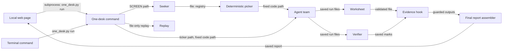

# Three Musketeers — Zainab, Ansh, Krishmi

Our client is a long-term individual investor seeking capital appreciation, with moderate risk tolerance and a preference for evidence-based recommendations supported by SEC filings and transparent valuation assumptions.

## Desk design

The local web page and terminal workflow use the same `one_desk.py` command. The pipeline uses saved files and a fixed code-defined order. A deterministic screen can select a ticker from the saved registry. The agent team saves filing-based work. The verifier and worksheet consume saved run files. A hook checks worksheet and report outputs before the final report assembler writes its report. Replay reads saved files only.

## Joins

- The seeker joins to the deterministic picker through the saved registry file.
- The ticker or selected name joins to the agent team through a fixed code path in `one_desk.py`.
- The verifier and worksheet join to the agent run through saved files in the run folder.
- The hook joins the worksheet and verifier evidence by reading saved outputs and validating numeric claims.
- The final assembler joins the guarded outputs by reading their saved files.
- The web page joins to the desk by starting the same `one_desk.py run` command in a subprocess.
- Replay joins only to saved run files. It makes no network or model calls.

## Team-owned feature

The team owns a prospective factor-check feature. It fixes each factor’s definition, direction, weight, point rule, and evaluation window before observing returns. It records each comparison and reports a hit rate. The saved prospective sample has zero comparisons, so no factor validation is claimed.

## Team roles

- Zainab — Integration and live-record lead; connects the tools under one command and maintains the live record and submission evidence.
- Ansh — Verification and evidence lead; checks report claims against SEC filings and records the assigned review results.
- Krishmi — Seeker and valuation lead; maintains factor definitions and the spinoff screen and completes the assigned worksheet recomputations.

## Live record so far

| Ticker | Release | Filing Accepted time | View time | Commit time | 24-hour result | Permanent GitHub evidence |
|---|---|---|---|---|---|---|
| MATW | Fourth-quarter and fiscal-year 2026 earnings, period ended September 30, 2026 | November 20, 2026, 08:22:14 EST (UTC−05:00); accession `0000063296-26-000118` | Not captured; no pre-reaction view time is asserted | November 20, 2026, 22:52:13 EST (UTC−05:00); commit [`bda922d626e4c59cd0ba1129063360731b01e421`](https://github.com/zainnn12/FIN67110-Fall2026/commit/bda922d626e4c59cd0ba1129063360731b01e421) | Inside; before November 21, 2026, 08:22:14 EST | [MATW live report at the recorded commit](https://github.com/zainnn12/FIN67110-Fall2026/blob/bda922d626e4c59cd0ba1129063360731b01e421/runs/live/MATW_TEAM_WORKSHEET_FINAL/MATW_LIVE_REPORT.md) · [saved live record](runs/live/MATW_TEAM_WORKSHEET_FINAL/live_record.json) |

The MATW report records verifier marks of 16 correct, 4 wrong, and 37 unsupported. The worksheet view and value range were not computed because aligned owner-cash-flow and share inputs were unavailable. The saved MATW live report does not establish a pre-reaction view.

## Checkpoint 3 evidence

### Lab 06

- [Corrected Lab 06 run](lab06_runs/SEEKER_2026-11-20_22-29-06-302032/seeker_report.md), [registry](lab06_runs/SEEKER_2026-11-20_22-29-06-302032/registry.json), and [citation audit](lab06_runs/SEEKER_2026-11-20_22-29-06-302032/citation_audit.json).
- [Zero-weight proof](lab06_runs/SEEKER_2026-11-20_22-29-06-302032/weight_zero_proof_2026-11-20_22-49-34-990421/proof.json) and [Lab 06 validation](LAB06_VALIDATION.md). The saved screen has no ranked name. Ansh’s validation update and review remain pending; see the [merge checklist](TEAMMATE_EVIDENCE_TO_MERGE.md).

### Lab 07

- The saved MSGR joined run’s [final report](runs/desk/DESK_2026-11-22_13-31-53-865623/final_report.md) and [manifest](runs/desk/DESK_2026-11-22_13-31-53-865623/run_manifest.json) show that the run completed. It selected Form 10-Q accession `0001628280-26-071325`, filed November 6, 2026, for the period ended September 30, 2026. The period predates the October 26, 2026 distribution.
- The [worksheet](runs/desk/DESK_2026-11-22_13-31-53-865623/agent/MSG_Rangers_Corp_2026-11-22_13-31-54-793145/worksheet.md), [verified report](runs/desk/DESK_2026-11-22_13-31-53-865623/agent/MSG_Rangers_Corp_2026-11-22_13-31-54-793145/verified_report.md), and [evidence-bound fallback summary](runs/lab07/MSGR_FALLBACK_REPORT.md) preserve the facts and the unsupported items. Owner cash flow, diluted shares, low and midpoint values, view, and conviction are not established or not computed. Krishmi’s manual review remains pending.

### Lab 08

- [Successful MSGR joined run](runs/desk/DESK_2026-11-22_13-31-53-865623/final_report.md) with [fixed node order](runs/desk/DESK_2026-11-22_13-31-53-865623/agent/MSG_Rangers_Corp_2026-11-22_13-31-54-793145/node_order.json), individual timings, and [manifest](runs/desk/DESK_2026-11-22_13-31-53-865623/run_manifest.json).
- [Clean hook PASS](runs/desk/DESK_2026-11-22_13-31-53-865623/hook_proofs/clean_result.txt), [seeded-error refusal](runs/desk/DESK_2026-11-22_13-31-53-865623/hook_proofs/seeded_result.txt), and [offline replay proof](runs/desk/DESK_2026-11-22_13-31-53-865623/replay/replay_proof.json). Replay recorded zero network calls, zero model calls, and identical report hashes and content.
- The timing-corrected [SCREEN result](runs/desk/DESK_2026-11-22_13-37-17-802277/final_report.md) has no ranked ticker. It does not select a company.

### Lab 09

- [NVDA fallback report](runs/lab09/DESK_2026-11-22_13-37-32-104848/fallback_report.md), [manifest](runs/lab09/DESK_2026-11-22_13-37-32-104848/agent/NVIDIA_CORP_2026-11-22_13-37-33-357977/manifest.json), and [failure record](runs/lab09/DESK_2026-11-22_13-37-32-104848/failure.json).
- [WMT fallback report](runs/lab09/DESK_2026-11-22_13-37-44-279695/fallback_report.md), [manifest](runs/lab09/DESK_2026-11-22_13-37-44-279695/agent/Walmart_Inc_2026-11-22_13-37-46-216137/manifest.json), and [failure record](runs/lab09/DESK_2026-11-22_13-37-44-279695/failure.json).
- Both joined runs stopped at the Investment Advisor call after HTTP 429 `credit_balance_exhausted`. Their final verified reports, worksheets, views, and deciding numbers were not produced. The [NVDA comparison](LAB09_NVDA_COMPARISON.md) records missing parts-alone and joined outputs. Manual checks remain pending.

### WRDS / CRSP

- [Eight event list](runs/wrds/costco_eight_events.csv), [saved CRSP source rows](runs/wrds/costco_crsp_daily.csv), [calculations and validation](runs/wrds/crsp_reaction.json), and [methodology and reproducible command](runs/wrds/crsp_reaction_methodology.md).
- The CRSP CIZ snapshot ends December 31, 2025. The analysis therefore does not include three 2026 SEC events.

### Local webpage

- [Local page evidence](runs/checkpoint3/LOCAL_PAGE_EVIDENCE.md) records the health response, start command, shared desk command, and failed MSGR UI request. The health response does not prove a complete desk run. No successful model-assisted report display is claimed.

## Manual reviews

- Ansh’s update to [Lab 06 validation](LAB06_VALIDATION.md) is **PENDING**. The assigned filing-claim checks must be completed by Ansh and recorded there.
- Krishmi’s expected manual review file, `runs/lab07/KRISHMI_MANUAL_REVIEW.md`, is **PENDING**. It must contain Krishmi’s two required worksheet recomputations and her own review result.
- The independent outside-team review is **PENDING**. No automated audit is represented as that review.
- [Test results](runs/checkpoint3/test_results.md) record the locked test suite. The [completion matrix](CHECKPOINT3_COMPLETION_MATRIX.md) records each requirement and remaining action. The [teammate evidence merge checklist](TEAMMATE_EVIDENCE_TO_MERGE.md) lists the expected files and required links.

## Disclosed limitations

- Lab 06 produced no ranked name.
- The prospective factor-check has zero comparisons.
- MSGR valuation and view were not computed because required post-distribution cash-flow and share inputs are not established.
- NVDA and WMT joined reports did not complete after the Investment Advisor calls returned HTTP 429 `credit_balance_exhausted`.
- The local page health check passed, but no successful model-assisted webpage report display was completed.
- Teammate and outside-team manual reviews remain pending.
- The subscribed CRSP data ends December 31, 2025.
- The MATW pre-reaction view time was not captured.
- The OpenAI completion smoke request passed, but later model calls exhausted the account credit. No further model call was made for this submission update.

This page submits the Checkpoint 3 proposal and available evidence. It does not claim that every Lab 07–09 deliverable or manual review is complete.
